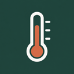
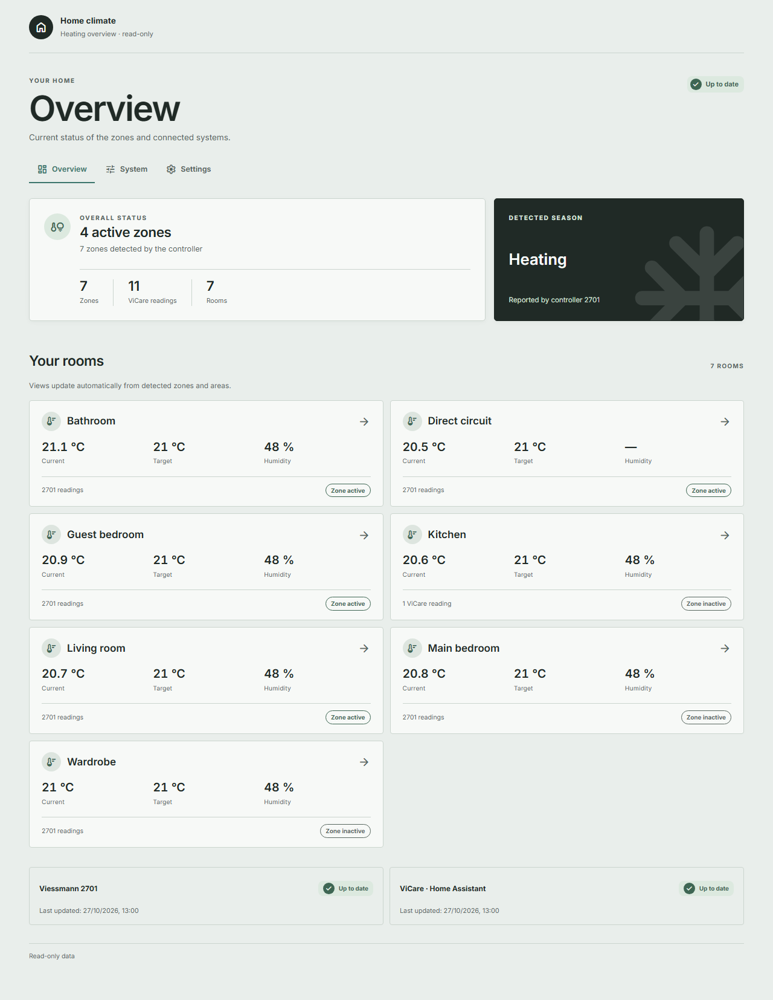

# Viessmann Dashboard

A read-only Home Assistant app (add-on) combining ViCare entities exposed by Home Assistant with direct polling of a Viessmann 2701 controller.

## Current features

The Supervisor app is in [`addon/viesmann_dashboard`](addon/viesmann_dashboard). It provides a responsive browser dashboard through Home Assistant Ingress and appears in the sidebar as **Viessmann Dashboard**, with a thermometer icon.

- **Live overview and room views:** rooms are generated from 2701 zones and Home Assistant areas, with temperature, target temperature, humidity when available, season, and activity. Dedicated room pages include a **Back to overview** link, and the direct circuit appears last.
- **Automatic ViCare discovery:** enabled reading entities from Home Assistant's official ViCare integration are discovered through the Supervisor Home Assistant API.
- **System view:** selected heat pump readings are grouped into today's electricity consumption, water temperatures, and operation. Renamed entities and sensors assigned to areas are supported; available readings depend on the device, API plan, and enabled entities.
- **Themes and languages:** automatic, light, and dark modes; Italian and English; Forest, Ocean, Violet, and custom palettes. Preferences are saved in the browser.
- **Custom colors:** an in-page dialog provides hue, saturation, lightness, and HEX input for background, surface, and accent colors, with separate light/dark settings, Apply/Cancel actions, and contrast feedback.
- **Responsive interaction:** room panels stack on narrow screens, and brief action feedback respects reduced-motion preferences.
- **Independent source status:** each source is marked fresh, stale, or unavailable. Stale begins after two configured polling intervals; the last successful readings remain visible after a failure.
- **Manual 2701 refresh:** the header button reads controller data immediately, reports progress/errors, and prevents overlapping polls.
- **Charts:** active-zone counts, room temperatures/humidity, and selected ViCare readings use a rolling in-memory history of up to 24 hours (1,440 samples per source). History starts with collected readings and resets when the app restarts; native units remain separate, and recent-reading tables accompany the charts.

Temperature and humidity sliders are **local previews only**: they do not send commands or change device settings. Humidity preview is available only in summer for a linked zone; the season always comes from the controller.

## Preview

Preview captured from the dashboard in English with **synthetic data**. More screenshots: [room view](docs/images/room-desktop-en.png), [system view](docs/images/system-desktop-en.png), [mobile overview](docs/images/overview-mobile-en.png), and [custom color dialog](docs/images/color-dialog-desktop-en.png).

## Installation and configuration

The app requires a **Home Assistant Supervisor** installation and supports **aarch64** and **amd64**. Home Assistant Container/Core installations are not supported by this package.

1. Add `https://github.com/itsmrma/viesmann-dashboard-hass` as a custom repository in the Home Assistant app store.
2. Install **Viessmann Dashboard**.
3. Configure the 2701 controller URL, its current `PHPSESSID` value, and the polling interval (1–60 minutes; default: 2).
4. Start the app and open the dashboard through Ingress. ViCare readings are discovered from enabled entities in Home Assistant's official ViCare integration.

The poller reads `index_refresh.php` and `zone_refresh.php?ids=<zone-id>` using the configured session cookie. It does not log in or renew the session automatically; replace the cookie when it expires and restart the app after changing its options.

See the [configuration and development guide](addon/viesmann_dashboard/DOCS.md) for details.

## Latest progress

The current app version is **0.1.8**. This release corrects active-zone detection and adds manual 2701 refresh and charts. Recent releases added the room and system views, customizable palettes, mobile layout improvements, the internal color dialog, room back navigation, and thermometer branding. The app and sidebar now share the **Viessmann Dashboard** name, and release notes are available in English in Home Assistant.

Read the [changelog](addon/viesmann_dashboard/CHANGELOG.md) for the full release history. Automated checks cover backend behavior, browser regressions, and release metadata. Verification details and screenshots are recorded for [issue #22](docs/issue-22/README.md) and [issue #24](docs/issue-24/README.md); checks on the installed app and physical PC/Mac/iOS devices remain in the consolidated [final release validation](addon/viesmann_dashboard/DOCS.md#final-release-validation).

## Development planning

Planning decisions are recorded in the [Wayfinder map](https://github.com/itsmrma/viesmann-dashboard-hass/issues/1). Agent and issue-tracker conventions are in [`AGENTS.md`](AGENTS.md) and [`docs/agents/`](docs/agents/); installed Matt Pocock skills are recorded in [`skills-lock.json`](skills-lock.json).

## License

This project is licensed under the [MIT License](LICENSE).

## Safety boundary

Write-capable controls remain outside this implementation and require a separate explicit scope decision.
