# Issue #22 — correzioni e verifica

Risolve il [testo dell’issue e i tre commenti](https://github.com/itsmrma/viesmann-dashboard-hass/issues/22), inclusi overflow mobile e revisione della scheda Impianto.

## Cambiamenti

- Ordine: Cucina → Sala → Matrimoniale → Cameretta → Armadi → Bagni → Circuito diretto. Le eventuali altre aree restano visibili prima del circuito diretto; con le sette zone questo occupa l’ultima riga da solo.
- Rimosso il cursore di anteprima inverno/estate. La stagione arriva dal controller; temperatura e umidità rimangono simulazioni locali senza comandi al dispositivo. L’umidità è disponibile solo in estate.
- Stessa geometria, font dei valori e posizione relativa dei cursori per i due pannelli. Su mobile si dispongono in colonna.
- Impianto raggruppa energia elettrica di oggi, temperature dell’acqua e dati operativi della pompa di calore. Elimina l’elenco di diagnostica e contatori secondari e include sensori assegnati a un’area. I nomi tecnici non occupano la vista principale; le sorgenti sono mostrate solo per distinguere più sensori della stessa misura.
- Metadati `translation_key` del registro Home Assistant per riconoscere anche entità rinominate. Nessuna somma tra consumi diversi, nessuna lettura inventata; zeri, dati non disponibili e unità native rimangono distinti.
- Versione add-on 0.1.5 per consentire la pubblicazione dell’immagine dopo il merge.

## Screenshot prima/dopo

Acquisizioni della pagina HTML effettiva con **dati sintetici**, non dell’impianto reale. La versione iniziale è il commit `e7c97af`. Le due serie usano la stessa fixture, tema chiaro Bosco, italiano e fuso Europe/Rome. Desktop: viewport 1280 × 900; mobile: 390 × 900. PNG a pagina intera; nessun ritocco.

| Vista | Prima | Dopo |
| --- | --- | --- |
| Panoramica desktop | 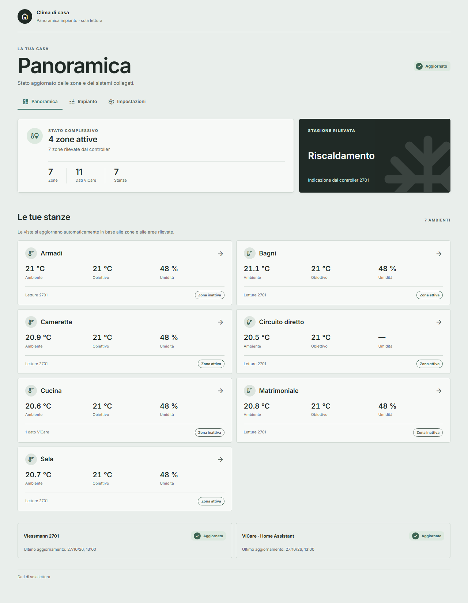 | 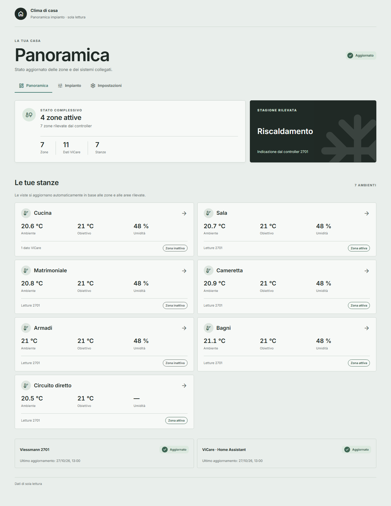 |
| Stanza desktop | 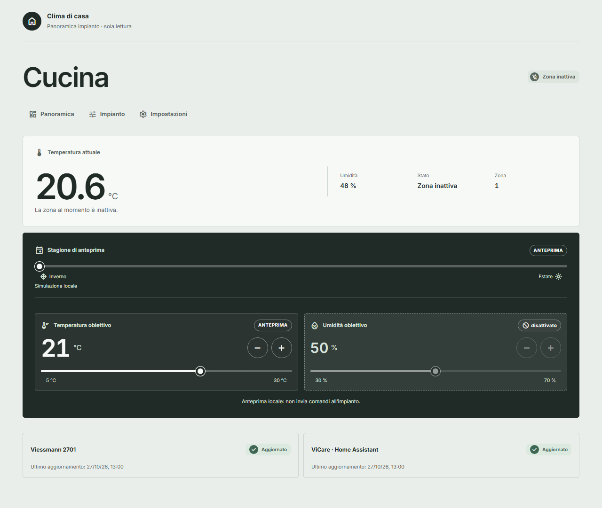 | 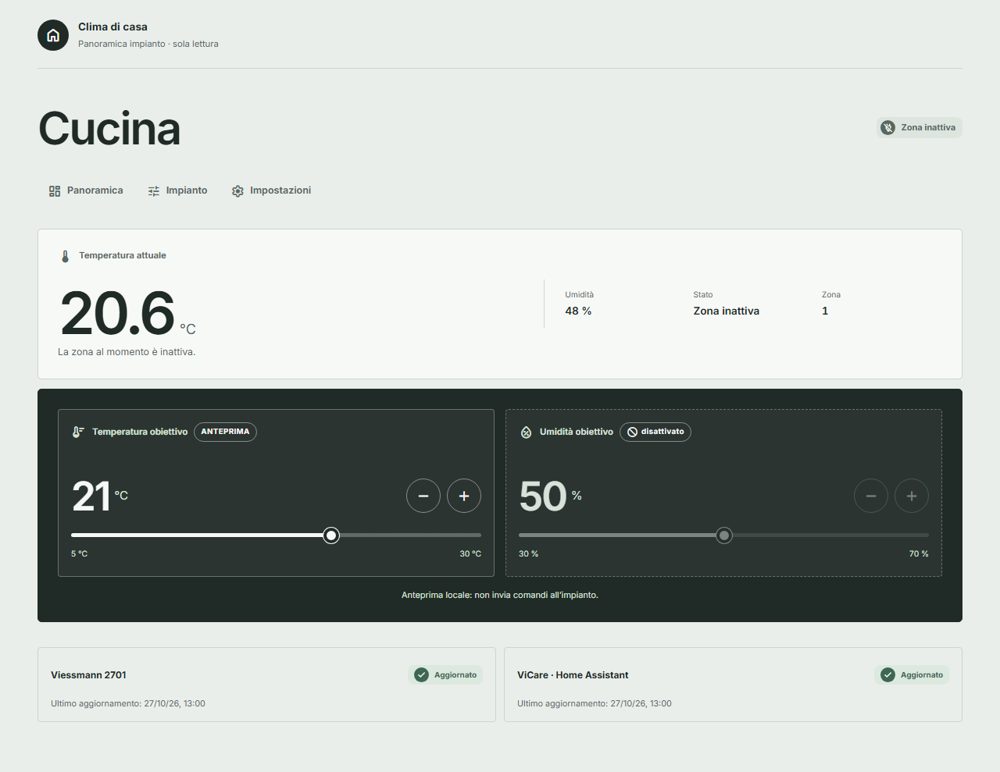 |
| Impianto desktop | 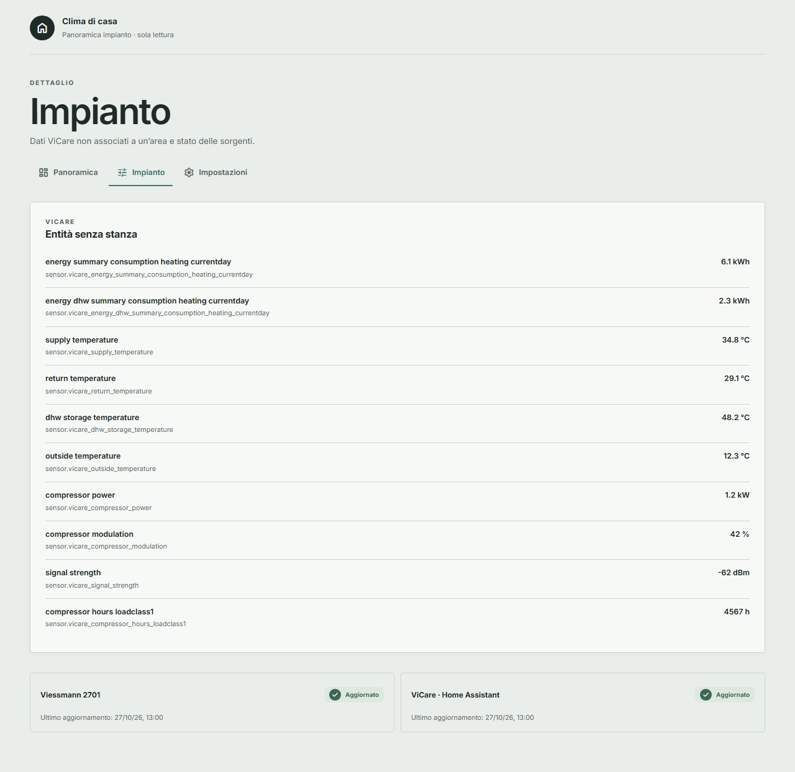 | 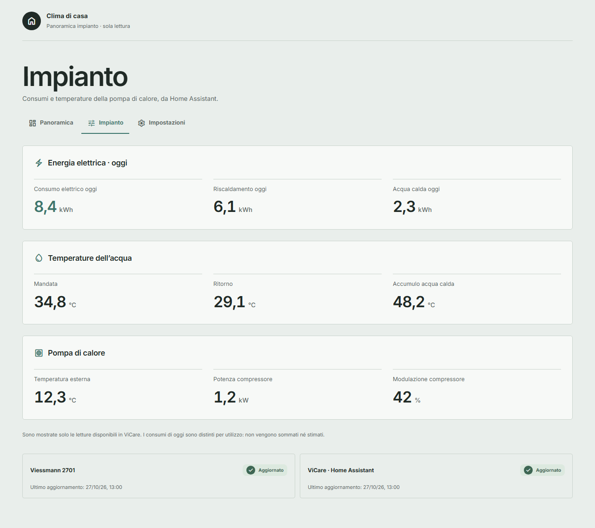 |
| Panoramica mobile | 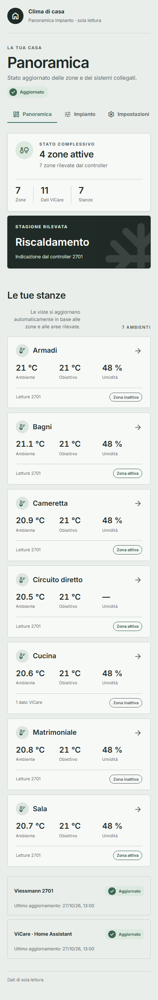 | 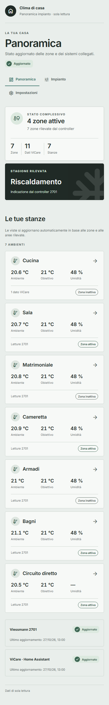 |
| Stanza mobile | 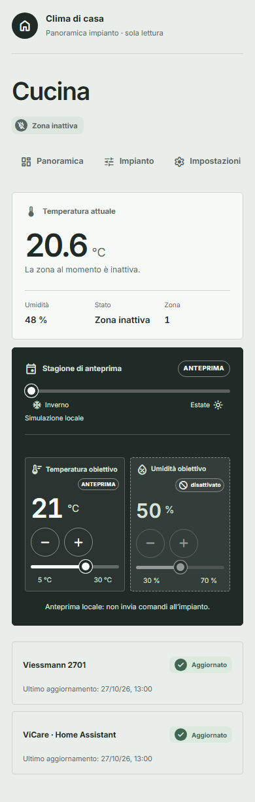 | 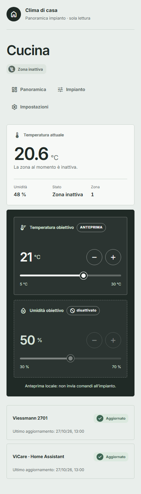 |
| Impianto mobile | 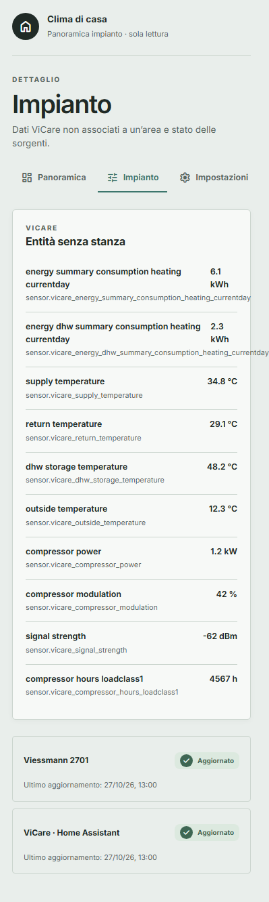 | 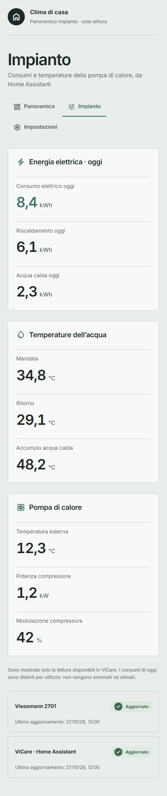 |

## Verifiche locali

Eseguite il 27 ottobre 2026:

| Controllo | Risultato |
| --- | --- |
| `python -m unittest discover -s tests -p 'test_*.py'` | 8 test superati, incluso passaggio dei metadati ViCare |
| `npm run test:ui` | 87 controlli superati in Chromium |
| Impeccable `detect` sull’HTML | Nessun finding statico (`[]`) |
| Parsing YAML | Configurazione add-on, traduzioni, repository e workflow validi |
| `git diff --check` | Superato |

La prima riproduzione browser aveva 16 errori: ordine alfabetico, selettore stagionale presente, font 51/30 px su desktop e 40,5/30 px su mobile, overflow Impianto fino a 399 px su viewport 320–390 px e assenza della selezione dei dati utili. La suite estesa eseguita contro l’HTML iniziale produce 50 controlli falliti. Il test Python sui metadati falliva con `KeyError: translation_key` prima della correzione.

La suite finale verifica Panoramica, Stanza, Impianto e Impostazioni a 320, 375, 390, 520, 600, 760, 768, 1024 e 1280 px; confronta altezze, font calcolati e posizione dei cursori; controlla l’assenza di sovrapposizione con i pulsanti. Verifica inoltre italiano/inglese, chiaro/scuro e tutte le quattro palette, nomi lunghi e più sensori per misura, valori zero/non disponibili, unità native, pagina vuota, aree aggiuntive, priorità dei metadati sull’ID, fallback senza metadati e assenza di richieste di scrittura. Tap e trascinamento del cursore sono sintetizzati tramite Chromium, senza dispositivo fisico.

I controlli UI sono aggiunti alla workflow esistente. La CI non viene attesa. Docker non è disponibile nell’ambiente locale: build immagine e verifiche sul sistema installato restano esplicitamente non eseguite qui. Il test Python esistente sul rifiuto di POST passa, ma Python 3.14 emette un `ResourceWarning` per l’oggetto HTTPError del test.

## Fonti per la selezione ViCare

- [Documentazione ufficiale Home Assistant ViCare](https://www.home-assistant.io/integrations/vicare/): sensori disponibili secondo i punti dati esposti e limiti del piano API. L’attributo `current_temperature` di un’entità climate può rappresentare la stanza oppure la mandata: non viene reinterpretato come temperatura dell’acqua.
- [Descrizioni dei sensori nell’integrazione](https://github.com/home-assistant/core/blob/dev/homeassistant/components/vicare/sensor.py): chiavi canoniche per consumi giornalieri, mandata/ritorno, accumulo, temperatura esterna, compressore e pressione.
- [Registro entità Home Assistant](https://github.com/home-assistant/core/blob/dev/homeassistant/helpers/entity_registry.py): campo `translation_key` usato per identificare la misura senza dipendere dal nome scelto dall’utente.

## Unica validazione manuale di rilascio

Da eseguire insieme alla checklist finale in [DOCS.md](../../addon/viesmann_dashboard/DOCS.md#final-release-validation), quando l’add-on è installato, su PC, Mac e iOS: dati reali/Ingress, nomi dei sensori, freschezza e guasti delle sorgenti; ordine stanze; geometria dei pannelli; stagione effettiva e disponibilità umidità; Impianto con sensori rinominati o assegnati a un’area; orientamento, zoom, trascinamento e scroll verticale attraverso i cursori in Safari/iOS; conferma che nessuna azione invii comandi. Le acquisizioni Chromium verificano il layout, non attestano il comportamento di Safari o dell’hardware reale.
